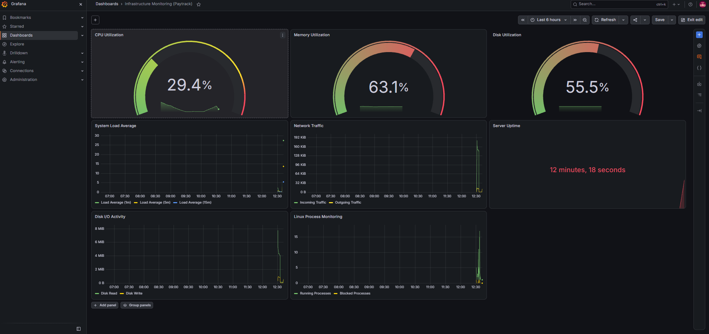

# Ansible Linux Server Automation & Infrastructure Monitoring


## Project Overview

This project demonstrates Linux server administration, infrastructure automation, and monitoring using Ansible, Prometheus, and Grafana.

The objective is to automate common Linux system administration tasks, deploy monitoring components, visualize infrastructure performance, and implement basic alerting and security configurations.

The environment is built in a personal virtualized laboratory using Oracle VirtualBox.

## Infrastructure Architecture

| Component | Configuration |
|---|---|
| Control Node | Ubuntu Linux |
| Managed Node | Debian 13 |
| Virtualization | Oracle VirtualBox |
| Automation | Ansible |
| Communication | SSH |
| Monitoring | Prometheus |
| Metrics Exporter | Node Exporter |
| Visualization | Grafana |
| Configuration Language | YAML |

### Architecture Diagram

```text
              ADMINISTRATOR
                    |
                    |
            UBUNTU CONTROL NODE
                voldemort
                    |
                    |
                 ANSIBLE
                    |
                    |
              SSH CONNECTION
                    |
                    |
              DEBIAN 13 SERVER
               MANAGED NODE
                    |
          -----------------------
          |          |          |
      PROMETHEUS  NODE EXPORTER GRAFANA
          |          |          |
          |     LINUX METRICS   |
          |          |          |
          <----------|----------|
                     |
              INFRASTRUCTURE
                DASHBOARD
                     |
               ALERTING
```

## Technologies Used

- **Linux:** Ubuntu and Debian
- **Automation:** Ansible
- **Monitoring:** Prometheus and Node Exporter
- **Visualization:** Grafana
- **Security:** Ansible Vault and TLS/HTTPS
- **Version Control:** Git and GitHub
- **Virtualization:** Oracle VirtualBox
- **Scripting and Configuration:** Bash and YAML

## Implementations

### 1. Ansible Installation and Configuration

- Installed and configured Ansible on the Ubuntu control node.
- Prepared the environment for remote Linux server management.
- Created inventory files to define managed hosts.

### 2. SSH Connectivity and Remote Administration

- Configured SSH communication between Ubuntu and Debian.
- Executed Ansible ad-hoc commands.
- Practiced remote package installation and system administration.

### 3. Ansible Playbook Development

Created playbooks to automate Linux administration tasks, including:

- Package installation.
- Linux system configuration.
- Variable management.
- Remote task execution.

### 4. Prometheus and Node Exporter Deployment

Automated the installation and configuration of Prometheus and Node Exporter using Ansible.

Collected Linux infrastructure metrics, including:

- CPU utilization.
- Memory utilization.
- Disk and filesystem usage.
- Network traffic.
- System load.
- Server performance metrics.

### 5. Grafana Infrastructure Monitoring

Integrated Grafana with Prometheus to visualize Linux server performance.

Developed monitoring panels for:

- CPU Utilization
- Memory Utilization
- Disk Utilization
- System Load Average
- Network Traffic
- Server Uptime
- Disk I/O Activity
- Linux Process Monitoring

### 6. Grafana Alerting and Email Notifications

- Configured Grafana alert rules.
- Set up email notifications using Gmail SMTP.
- Used an Ansible-managed configuration for SMTP credentials.
- Protected sensitive credentials using Ansible Vault.

### 7. Grafana HTTPS Configuration

- Generated a self-signed TLS certificate using Ansible.
- Configured Grafana to use HTTPS.
- Automated certificate and private-key configuration.

**Note:** The laboratory uses a self-signed certificate. A trusted certificate authority should be used for production environments.

## Grafana Dashboard Preview



The dashboard provides an overview of Linux server performance and infrastructure health.

## Repository Structure

```text
ansible-linux-automation/
│
├── README.md
│
├── documentation/
│
├── inventory/
│   └── inventory.ini
│
├── group_vars/
│   └── linux_servers/
│       ├── vars.yml
│       └── vault.example.yml
│
├── playbooks/
│   ├── basics/
│   │   ├── first-playbook.yml
│   │   ├── install_htop.yml
│   │   └── variables-playbook.yml
│   │
│   └── monitoring/
│       ├── grafana.yml
│       ├── prometheus.yml
│       ├── configure_grafana_smtp.yml
│       ├── generate_grafana_tls.yml
│       └── configure_grafana_https.yml
│
├── prometheus/
│   └── README.md
│
└── grafana/
    ├── README.md
    ├── alert-rules/
    ├── dashboards/
    │   └── infrastructure-monitoring-dashboard.json
    └── screenshots/
        └── infrastructure-monitoring-dashboard.png
```

## Security Practices

Security considerations implemented in this project include:

- SSH-based remote administration.
- Ansible Vault for protecting sensitive credentials.
- Exclusion of private keys and secret files through `.gitignore`.
- HTTPS configuration for Grafana.
- Use of example configuration files instead of publishing actual credentials.

Never commit plaintext passwords, private keys, or unencrypted secret files to GitHub.

## Project Objectives

- Improve Linux system administration skills.
- Automate infrastructure tasks using Ansible.
- Develop reusable Ansible playbooks.
- Deploy and configure Linux monitoring components.
- Build infrastructure monitoring dashboards.
- Configure monitoring alerts and email notifications.
- Apply basic security practices to infrastructure automation.
- Develop practical DevOps skills.

## Future Enhancements

- Automate Linux user and group management.
- Implement automated security updates and patch management.
- Expand monitoring to multiple Linux servers.
- Improve Ansible role and project organization.
- Implement Ansible linting and automated validation.
- Integrate GitHub Actions CI/CD pipelines.
- Explore Docker, Terraform, and Kubernetes.

## Author

**John Paul Javier**

IT Infrastructure Engineer | Linux | Ansible | Grafana | Prometheus | Splunk | AWS

GitHub: `johnpauljavier`

---

This repository is part of my continuous learning journey in Linux Administration, Infrastructure Automation, Monitoring, and DevOps Engineering.
