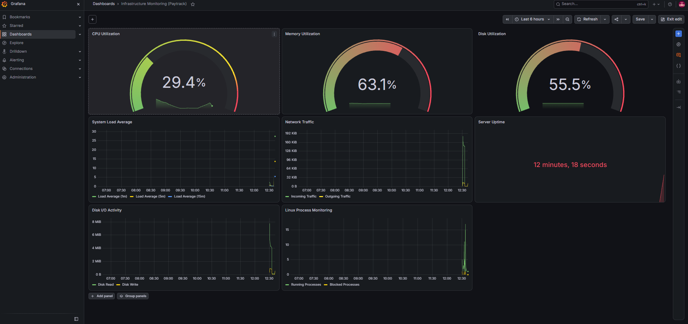

# Grafana Infrastructure Monitoring

## Overview

Grafana is used to visualize Linux server performance metrics collected by Prometheus.

Grafana and Prometheus are deployed on the same Debian managed server through Ansible automation.

## Dashboard

The repository includes an exported Grafana dashboard in JSON format.

File:

`dashboards/infrastructure-monitoring-dashboard.json`

Screenshot:

## Monitoring Panels

The dashboard includes:

- CPU Utilization
- Memory Utilization
- Disk Utilization
- System Load Average
- Network Traffic
- Server Uptime
- Disk I/O Activity
- Linux Process Monitoring

## Alerting

Grafana alert rules and email notification capabilities are configured for infrastructure monitoring.

Gmail SMTP configuration is automated through Ansible.

Credentials are supplied through Ansible Vault rather than hardcoded in playbooks.

## Security

HTTPS is configured using a self-signed TLS certificate generated through Ansible.

For production environments, use certificates issued by a trusted Certificate Authority.

## Deployment Playbooks

| Playbook | Purpose |
|---|---|
| `grafana.yml` | Install Grafana |
| `configure_grafana_smtp.yml` | Configure Gmail SMTP |
| `generate_grafana_tls.yml` | Generate TLS certificate |
| `configure_grafana_https.yml` | Enable HTTPS |

## Importing the Dashboard

1. Open Grafana.
2. Navigate to Dashboards.
3. Select New → Import.
4. Upload the exported JSON file.
5. Select the appropriate Prometheus data source.
6. Import the dashboard.
